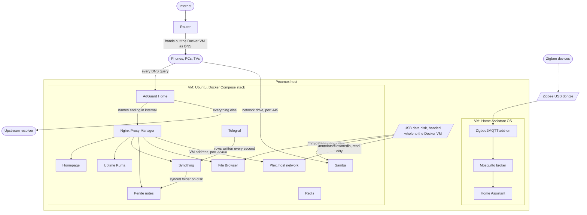
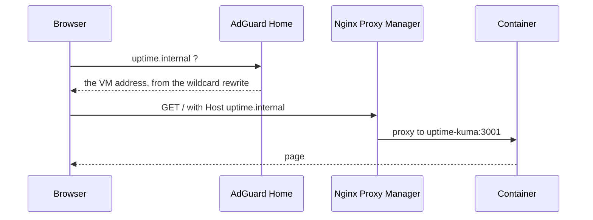

# Home Lab Stack

> A Proxmox host running two virtual machines: Home Assistant for the smart home, and Ubuntu with a Docker Compose stack for network services. Everything is reachable by private `.internal` names. Nothing is exposed to the internet.

---

### What this is

A template for a small always-on server. A mini PC runs Proxmox. One virtual machine runs Home Assistant OS with a Zigbee dongle passed through to it. A second runs Ubuntu Server with Docker, where one Compose file brings up the services below. AdGuard Home answers DNS for the whole network, Nginx Proxy Manager turns `something.internal` into the right container, and the rest are the services you actually use.

Instructions are written against placeholders in angle brackets so they stay reusable. Fill in your own addresses.

| Placeholder | Meaning |
|---|---|
| `<router>` | Your router, which hands out addresses and DNS on the LAN |
| `<proxmox-host>` | The Proxmox machine, reached on port 8006 |
| `<ha-vm-ip>` | The Home Assistant virtual machine |
| `<docker-vm-ip>` | The Ubuntu virtual machine running the Compose stack |
| `<user>` | The login you create during the Ubuntu install |
| `<vmid>` | A virtual machine's number in Proxmox |

Concrete example, the lab these documents were written from:

```text
<router>         192.168.1.1
<proxmox-host>   192.168.1.10
<ha-vm-ip>       192.168.1.11
<docker-vm-ip>   192.168.1.12
```

---

### Architecture



---

### Services

| Service | Internal name | Host port | Container port | What it does |
|---|---|---|---|---|
| AdGuard Home | `adguard.internal` | 7777 | 7777 | Network wide DNS with ad and tracker blocking, plus the `.internal` rewrites |
| Nginx Proxy Manager | `nginx-proxmox.internal` | 81 | 81 | Reverse proxy, maps each internal name to a container |
| Homepage | `dashboard-proxmox.internal` | 7778 | 3000 | Dashboard linking to everything else |
| Uptime Kuma | `uptime.internal` | 7779 | 3001 | Polls the other services and alerts when one dies |
| Syncthing | `syncthing.internal` | 7780 | 8384 | File sync between machines |
| Perlite | `notes.internal` | 7781 | 80 | Renders the synced notes folder as a read only website |
| Redis | none, TCP only | 6379 | 6379 | In-memory cache, unauthenticated and with no data volume, used by AscendWebSearch below |
| AscendWebSearch | `ascend-scrapper.internal` | 7021 | 7021 | Web search and scraping API, a separate Compose project joined to this one only through the shared proxy network |
| File Browser | `drive.internal` | 7782 | 80 | Web access to the shared folder on the USB data disk |
| Samba | `\\drive.internal\files`, not proxied | 445 | 445 | The same folder as a network drive |
| Plex | `plex.internal`, host network | 32400 | 32400 | Films and series from the USB data disk, direct play only |
| Telegraf | none, host network | none | none | Records a ping and DNS row every second, an HTTP row every 5 seconds, and a download, upload and latency row every 10 minutes, as proof of short provider outages, written into the Syncthing folder |

Nginx Proxy Manager also binds 80 and 443 for proxied traffic, AdGuard binds 53 for plain DNS plus 853 and 784 for the encrypted variants, and Syncthing binds 22000 and 21027 for its own peer protocol.

Perlite is two containers rather than one. The engine renders the markdown and has no published port, and `perlite-web` is the nginx that serves it. Setting it up takes a few extra steps, so it has its own page: [perlite_notes.md](perlite_notes.md).

Redis has no proxy entry because it speaks its own wire protocol, not HTTP, so Nginx Proxy Manager has nothing to forward. AscendWebSearch lives in its own directory with its own Compose file rather than in `compose.yaml`, since it is a different project with a different lifecycle. Both are covered together in [ascend_web_search.md](ascend_web_search.md).

Telegraf has no proxy entry and no published port either. It runs on `network_mode: host`, writes its rows straight into a folder, and has no web interface for anyone to open. [network_watch.md](network_watch.md) covers what it records and why.

File Browser and Samba serve the same folder, `/mnt/data/files`, on a USB disk the Proxmox host hands whole to the Docker VM. The Plex library is the `media` folder inside it, so films are copied in through the network drive or File Browser like any other file, and Plex mounts only that folder, read only. Samba has no proxy entry because SMB is not web traffic: `drive.internal` reaches it only because the AdGuard wildcard rewrite sends every `.internal` name to the VM. Plex runs on `network_mode: host` with a hard limit of 1.5 CPU cores, so its proxy entry points at the VM's address and port 32400. The disk is covered in [lan_storage.md](lan_storage.md), Plex in [plex_media_server.md](plex_media_server.md).

Proxmox is not a container and is not in the Compose file, so its proxy entry points at an address rather than a container name. [nginx_proxy_manager.md](nginx_proxy_manager.md) covers that case. Home Assistant is reached directly on `<ha-vm-ip>:8123`, since it is the one service you open constantly from phones that already have it bookmarked.

---

### Quick start

The Proxmox host has to exist first, then the virtual machine. Follow [proxmox_host_install.md](proxmox_host_install.md), then [proxmox_docker_vm.md](proxmox_docker_vm.md), then come back here.

This stack runs from a plain copy of two files on the virtual machine, not a clone of this repository. Create the folder that holds the Telegraf config first:

```bash
mkdir -p /opt/docker-stack/telegraf
```

Copy [compose.yaml](compose.yaml) to `/opt/docker-stack/compose.yaml`, with FileZilla, with `scp`, or by downloading it directly:

```bash
curl -fsSL https://raw.githubusercontent.com/Lukk17/InstallationHelper/master/homelab/compose.yaml -o /opt/docker-stack/compose.yaml
```

Copy [telegraf/telegraf.conf](telegraf/telegraf.conf) to `/opt/docker-stack/telegraf/telegraf.conf` the same way:

```bash
curl -fsSL https://raw.githubusercontent.com/Lukk17/InstallationHelper/master/homelab/telegraf/telegraf.conf -o /opt/docker-stack/telegraf/telegraf.conf
```

Create the per-service folders the other containers bind mount into, so Docker never has to invent one of them itself and hand it to root. `/opt/docker-stack` already belongs to you, from [proxmox_docker_vm.md](proxmox_docker_vm.md), so none of this needs `sudo`:

```bash
mkdir -p /opt/docker-stack/{nginx/data,nginx/letsencrypt,adguard/work,adguard/conf,homepage/config,uptime-kuma/data,syncthing/config,syncthing/data,syncthing/data/network-watch,filebrowser/data,plex/config,plex/transcode}
```

Create `/opt/docker-stack/.env` with the network drive login before the first start, because the Compose file refuses to start without it rather than fall back to the Samba image's default password. The file holds placeholders here, fill in your own values:

```text
SAMBA_USER=<samba-user>
SAMBA_PASS=<samba-password>
```

File Browser, Samba and Plex also need the USB data disk mounted at `/mnt/data` and a config file for File Browser, both covered in [lan_storage.md](lan_storage.md). Until the disk is there those three cannot start, because the Compose file binds their data folder with `create_host_path: false`. Whether `docker compose up -d` still starts every other service in that case, or stops at the first one it cannot create, has not been measured yet. If the stack does not come up, start the other services by name:

```bash
cd /opt/docker-stack && docker compose up -d nginx-proxy-manager adguard-home homepage uptime-kuma syncthing perlite perlite-web redis telegraf
```

Perlite needs one more folder and a config file of its own before it will serve anything, covered in [perlite_notes.md](perlite_notes.md), and Telegraf needs a one-time sysctl check for its ping permission, covered in [network_watch.md](network_watch.md).

Start everything:

```bash
cd /opt/docker-stack && docker compose up -d
```

Updating later means copying the newer `compose.yaml` and `telegraf.conf` over the old ones the same way, then running that same `cd /opt/docker-stack && docker compose up -d` again.

Upgrade note for a deployment set up before 2026-10-10: the Compose file now reads the Samba login from `SAMBA_USER` and `SAMBA_PASS` in `/opt/docker-stack/.env` and refuses to run without them, instead of falling back to the Samba image's default password. Compose checks those two values whenever it reads the file, so until both lines are in `.env`, every `docker compose` command for the whole stack stops with an error naming the missing variable, not only the one for Samba. Add both lines, as shown above, before you copy the newer `compose.yaml` over the old one. Use the login the drive already had, so the machines that map it keep working.

Then configure the two services that need it: [adguard_dns.md](adguard_dns.md) first, because AdGuard owns the `.internal` names, and [nginx_proxy_manager.md](nginx_proxy_manager.md) second.

---

### Configuration

The values in the Compose file that are host specific sit in the file directly, since none of them is a secret.

| Setting | Default here | Why you might change it |
|---|---|---|
| `HOMEPAGE_ALLOWED_HOSTS` | `dashboard-proxmox.internal` | Homepage rejects any hostname missing from this list. Add `<docker-vm-ip>:7778` if you also open it by address |
| `PUID` | `1000` | User ID that owns the Syncthing files on the host |
| `PGID` | `1000` | Group ID for the same |
| `TZ` (Syncthing) | `Europe/Warsaw` | Timezone inside the Syncthing container |
| Telegraf `user` | `1000:1000` | Set directly in the Compose file rather than as an environment variable, so Telegraf can write into the Syncthing folder the same `PUID`/`PGID` above owns |
| Telegraf `TZ` | `Europe/Warsaw` | Timezone inside the Telegraf container, set separately from Syncthing's |
| `SAMBA_USER`, `SAMBA_PASS` | none, set in `.env` | The network drive login, see [lan_storage.md](lan_storage.md) |
| `PLEX_CLAIM` | empty, set in `.env` once | One-time token linking Plex to your account, see [plex_media_server.md](plex_media_server.md) |
| Plex `cpus` | `1.5` | Hard CPU ceiling for Plex, out of the Docker VM's four cores |
| Telegraf `network_mode` | `host` | Telegraf shares the VM's network namespace instead of the bridge network, which the ping checks in [network_watch.md](network_watch.md) need |

The Compose file carries no passwords or tokens. The Samba login, and the one-time Plex claim token, come from `/opt/docker-stack/.env` on the VM, which never enters version control. Every other service sets its own credentials on first run and stores them under `/opt/docker-stack/`.

The `proxy-tier` network in `compose.yaml` carries an explicit `name: proxy-tier` rather than letting Docker derive one from the directory, so that the separate AscendWebSearch Compose project can join it reliably. Applying that on a stack that is already running takes `docker compose down` followed by `docker compose up -d`, which recreates every container here. No data is lost, since every service in this file keeps its state on the bind mounts under `/opt/docker-stack/` listed below, not inside the container. Details on what joins that network and why are in [ascend_web_search.md](ascend_web_search.md).

Persistent data lives under `/opt/docker-stack/`, one directory per service, bind mounted into the containers. The shared files, with the Plex library inside them, are the exception: they live on the USB data disk under `/mnt/data`, which Proxmox backups skip on purpose. The Compose file alone will not restore your setup, because AdGuard filters, proxy hosts, dashboard layout, uptime monitors and Syncthing keys all live in those directories.

Every image tag in this file is pinned to an exact version rather than `latest`. An unattended pull with floating tags can hand you a breaking major release on a random Tuesday. Bump a tag deliberately, one service at a time. The separate AscendWebSearch stack makes one deliberate exception for the one image published from this account, described in [ascend_web_search.md](ascend_web_search.md).

---

### How a request travels



An ad domain ends earlier. AdGuard answers `0.0.0.0` and the browser has nowhere to connect.

---

### Troubleshooting

The whole network loses DNS. The AdGuard container is down, or something else grabbed port 53 on the virtual machine. Check `docker ps` and see [adguard_dns.md](adguard_dns.md) for the port 53 conflict.

Internal names fail but the internet works. The router is handing out a public DNS server, or the wildcard rewrite is missing in AdGuard.

One internal name returns 502. That container is stopped, or the port in its proxy host entry is wrong. The forward port is the container port, not the published host port.

Homepage answers "Host validation failed". The hostname is not in `HOMEPAGE_ALLOWED_HOSTS`. Add it in `compose.yaml` and recreate the container, as covered in [homepage_dashboard.md](homepage_dashboard.md).

Syncthing cannot write its files. The host directories under `/opt/docker-stack/syncthing/` are not owned by the `PUID` and `PGID` you set. See [syncthing.md](syncthing.md).

The notes site is empty. The Syncthing folder path is not `/data/notes`. See [perlite_notes.md](perlite_notes.md).

File Browser, Samba or Plex will not start and the error names `/mnt/data`. The USB data disk is not mounted. See [lan_storage.md](lan_storage.md).

A film buffers or fails to play. Plex is not allowed to convert video, so the file is in a format that player cannot play directly. See [plex_media_server.md](plex_media_server.md).

Zigbee devices went offline. The USB dongle is not attached to the Home Assistant machine, or the Zigbee2MQTT add-on stopped. See [home_assistant_vm.md](home_assistant_vm.md).

---

### Docs map

| Doc | What's in it |
|---|---|
| [proxmox_host_install.md](proxmox_host_install.md) | Installing Proxmox on the mini PC, updating it, node shell, backup retention |
| [proxmox_docker_vm.md](proxmox_docker_vm.md) | Creating the Ubuntu VM, installing Docker Engine, freeing port 53, growing its disk |
| [home_assistant_vm.md](home_assistant_vm.md) | Building the Home Assistant OS VM with `qm`, and Zigbee USB passthrough |
| [home_assistant_backup.md](home_assistant_backup.md) | Home Assistant's own backups, the encryption key, and restoring |
| [adguard_dns.md](adguard_dns.md) | AdGuard first run, the `.internal` wildcard rewrite, upstream resolvers, rate limit, blocklists, router DNS cutover |
| [nginx_proxy_manager.md](nginx_proxy_manager.md) | Adding the proxy host entries and verifying them |
| [syncthing.md](syncthing.md) | Pairing devices, folder paths, ownership, versioning |
| [perlite_notes.md](perlite_notes.md) | Publishing the synced notes folder as a website |
| [homepage_dashboard.md](homepage_dashboard.md) | Dashboard tiles, allowed hosts, and why the status check bypasses DNS |
| [uptime_kuma.md](uptime_kuma.md) | Service monitors and network monitors, why Proxmox is a ping, why AdGuard gets two checks |
| [network_watch.md](network_watch.md) | Telegraf recording proof of short provider outages, and reading it back afterward |
| [lan_storage.md](lan_storage.md) | The USB data disk handed to the Docker VM, File Browser at `drive.internal`, and the Samba network drive |
| [plex_media_server.md](plex_media_server.md) | Plex with host networking, the CPU cap, the transcoding settings, and which file formats to store |
| [ascend_web_search.md](ascend_web_search.md) | AscendWebSearch: containers, secrets, joining the proxy network, the ngrok exposure |
| [backup_restore.md](backup_restore.md) | Backing up the VMs and the service data, and restoring both |
| [agent_access.md](agent_access.md) | Access for an AI agent without a password: a Proxmox API token, read only or able to change virtual machines, an SSH key for the Docker VM, the Syncthing API key, and how to revoke each |
