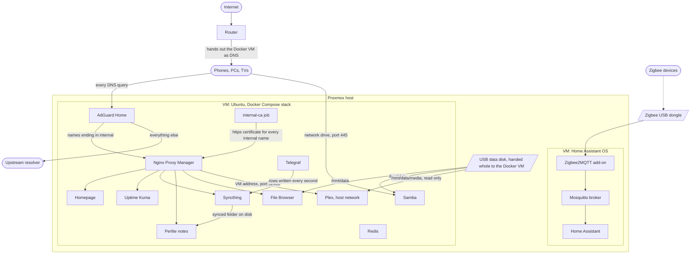
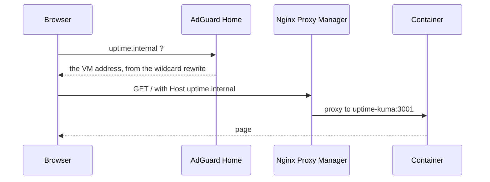

# Home Lab Stack

> A Proxmox host running two virtual machines: Home Assistant for the smart home, and Ubuntu with a Docker Compose stack for network services. Everything is reachable by private `.internal` names. Nothing is exposed to the internet.

---

### What this is

A template for a small always-on server. A mini PC runs Proxmox. One virtual machine runs Home Assistant OS with a Zigbee dongle passed through to it. A second runs Ubuntu Server with Docker, where one Compose file brings up the services below. AdGuard Home answers DNS for the whole network, Nginx Proxy Manager turns `something.internal` into the right container, and the rest are the services you actually use.

Instructions are written against placeholders in angle brackets so they stay reusable. Fill in your own addresses.

| Placeholder | Meaning |
|---|---|
| `<router>` | Your router, which hands out addresses and DNS on the LAN |
| `<proxmox-host>` | The Proxmox machine, reached on port 8006 |
| `<ha-vm-ip>` | The Home Assistant virtual machine |
| `<docker-vm-ip>` | The Ubuntu virtual machine running the Compose stack |
| `<user>` | The login you create during the Ubuntu install |
| `<vmid>` | A virtual machine's number in Proxmox |
| `<repo>` | The folder of your local clone of this repository |

Concrete example, the lab these documents were written from:

```text
<router>         192.168.1.1
<proxmox-host>   192.168.1.10
<ha-vm-ip>       192.168.1.11
<docker-vm-ip>   192.168.1.12
```

---

### Architecture



---

### Services

| Service | Internal name | Host port | Container port | What it does |
|---|---|---|---|---|
| AdGuard Home | `adguard.internal` | 7777 | 7777 | Network wide DNS with ad and tracker blocking, plus the `.internal` rewrites |
| Nginx Proxy Manager | `nginx-proxmox.internal` | 81 | 81 | Reverse proxy, maps each internal name to a container |
| Homepage | `dashboard-proxmox.internal` | 7778 | 3000 | Dashboard linking to everything else |
| Uptime Kuma | `uptime.internal` | 7779 | 3001 | Polls the other services and alerts when one dies |
| Syncthing | `syncthing.internal` | 7780 | 8384 | File sync between machines |
| Perlite | `notes.internal` | 7781 | 80 | Renders the synced notes folder as a read only website |
| Redis | none, TCP only | 6379 | 6379 | In-memory cache, unauthenticated and with no data volume, used by ascend-web-hunter below |
| ascend-web-hunter | `ascend-web-hunter.internal` | 7021 | 7021 | Web search and scraping API from AscendAI, a separate Compose project joined to this one only through the shared proxy network |
| File Browser | `files.internal` | 7782 | 80 | Web access to the whole USB data disk |
| Samba | `\\files.internal\files`, not proxied | 445 | 445 | The same folder as a network drive |
| Plex | `plex.internal`, host network | 32400 | 32400 | Films and series from the USB data disk, direct play only |
| Telegraf | none, host network | none | none | Records a ping and DNS row every second, an HTTP row every 5 seconds, and a download, upload and latency row every hour, as proof of short provider outages, written into the Syncthing folder |
| internal-ca | none, one-shot job | none | none | Signs the `https` certificate for every `.internal` name from your own certificate authority and hands it to Nginx Proxy Manager, then exits, see [internal_ca.md](internal_ca.md) |

Nginx Proxy Manager also binds 80 and 443 for proxied traffic, and answers every `.internal` name on both, plain `http` on 80 and `https` on 443, AdGuard binds 53 for plain DNS plus 853 and 784 for the encrypted variants, and Syncthing binds 22000 and 21027 for its own peer protocol.

Perlite is two containers rather than one. The engine renders the markdown and has no published port, and `perlite-web` is the nginx that serves it. Setting it up takes a few extra steps, so it has its own page: [perlite_notes.md](perlite_notes.md).

Redis has no proxy entry because it speaks its own wire protocol, not HTTP, so Nginx Proxy Manager has nothing to forward. ascend-web-hunter lives in its own directory, [ascend-web-hunter_deploy/](ascend-web-hunter_deploy/), with its own Compose file rather than in `compose.yaml`, since it is a different project with a different lifecycle. Both are covered together in [ascend_web_hunter.md](ascend_web_hunter.md).

Telegraf has no proxy entry and no published port either. It runs on `network_mode: host`, writes its rows straight into a folder, and has no web interface for anyone to open. [network_watch.md](network_watch.md) covers what it records and why.

File Browser and Samba serve the same folder, `/mnt/data`, the top of a USB disk the Proxmox host hands whole to the Docker VM. The Plex library is the `media` folder at the top of that disk, so films are copied in through the network drive or File Browser like any other file, and Plex mounts only that folder, read only. Samba has no proxy entry because SMB is not web traffic: `files.internal` reaches it only because the AdGuard wildcard rewrite sends every `.internal` name to the VM. Plex runs on `network_mode: host` with a hard limit of 1.5 CPU cores, so its proxy entry points at the VM's address and port 32400. The disk is covered in [lan_storage.md](lan_storage.md), Plex in [plex_media_server.md](plex_media_server.md).

Proxmox is not a container and is not in the Compose file, so its proxy entry points at an address rather than a container name. [nginx_proxy_manager.md](nginx_proxy_manager.md) covers that case. Home Assistant is reached directly on `<ha-vm-ip>:8123`, since it is the one service you open constantly from phones that already have it bookmarked.

---

### Quick start

The Proxmox host has to exist first, then the virtual machine. Follow [proxmox_host_install.md](proxmox_host_install.md), then [proxmox_docker_vm.md](proxmox_docker_vm.md), then come back here.

This stack runs from a plain copy of four files on the virtual machine, not a clone of this repository. Create the folders that hold the Telegraf config and the certificate job first:

```bash
mkdir -p /opt/docker-stack/telegraf /opt/docker-stack/internal-ca
```

Copy [compose.yaml](compose.yaml), [telegraf/telegraf.conf](telegraf/telegraf.conf), [internal-ca/issue.sh](internal-ca/issue.sh) and [internal-ca/server_proxy.conf](internal-ca/server_proxy.conf) onto the VM from your clone, with the `scp` commands in [Deploying from your clone](#deploying-from-your-clone) below. Leave its `docker compose` steps for the end of this quick start.

Create the per-service folders the other containers bind mount into, so Docker never has to invent one of them itself and hand it to root. `/opt/docker-stack` already belongs to you, from [proxmox_docker_vm.md](proxmox_docker_vm.md), so none of this needs `sudo`:

```bash
mkdir -p /opt/docker-stack/{nginx/data,nginx/letsencrypt,adguard/work,adguard/conf,homepage/config,uptime-kuma/data,syncthing/config,syncthing/data,syncthing/data/network-watch,filebrowser/data,plex/config,plex/transcode}
```

Create `/opt/docker-stack/.env` with the network drive login before the first start, because the Compose file refuses to start without it rather than fall back to the Samba image's default password. The commands, and a check that neither value is empty, are in [The Samba login file](lan_storage.md#the-samba-login-file).

Add the three lines of your local certificate authority to the same file before the first start as well, because the Compose file refuses to start without them too. Making the authority and appending the lines are in [internal_ca.md](internal_ca.md).

File Browser, Samba and Plex also need the USB data disk mounted at `/mnt/data` and a config file for File Browser, both covered in [lan_storage.md](lan_storage.md). Until the disk is there Plex cannot start, because the Compose file binds its library folder, `/mnt/data/media`, with `create_host_path: false`, and that folder exists only on the disk. File Browser and Samba need only the mount point `/mnt/data`, so they start without the disk, and the immutable flag from [Protect the empty mount point](lan_storage.md#protect-the-empty-mount-point) keeps them from writing anything onto the system disk. Whether `docker compose up -d` still starts every other service when Plex cannot start, or stops at the first one it cannot create, has not been measured yet. If the stack does not come up, start the other services by name:

```bash
cd /opt/docker-stack && docker compose up -d nginx-proxy-manager adguard-home homepage uptime-kuma syncthing perlite perlite-web redis telegraf
```

Perlite needs one more folder and a config file of its own before it will serve anything, covered in [perlite_notes.md](perlite_notes.md), and Telegraf needs a one-time sysctl check for its ping permission, covered in [network_watch.md](network_watch.md).

Start everything:

```bash
cd /opt/docker-stack && docker compose up -d
```

Updating later means following [Deploying from your clone](#deploying-from-your-clone).

Upgrade note for a deployment set up before 2026-10-10: the Compose file now reads the Samba login from `SAMBA_USER` and `SAMBA_PASS` in `/opt/docker-stack/.env` and refuses to run without them, instead of falling back to the Samba image's default password. Compose checks those two values whenever it reads the file, so until both lines are in `.env`, every `docker compose` command for the whole stack stops with an error naming the missing variable, not only the one for Samba. Add both lines, as shown above, before you copy the newer `compose.yaml` over the old one. Use the login the drive already had, so the machines that map it keep working.

Upgrade note for a deployment set up before 2026-10-24: the Compose file now has the `internal-ca` job, which reads `INTERNAL_CA_CERT_B64`, `INTERNAL_CA_KEY_B64` and `INTERNAL_DNS_NAMES` from `/opt/docker-stack/.env` and refuses to run without them, and again every `docker compose` command for the whole stack stops until all three are there. Make the certificate authority and append the three lines as [internal_ca.md](internal_ca.md) says, create `/opt/docker-stack/internal-ca` with its two files, and only then copy the newer `compose.yaml`.

Then configure the two services that need it: [adguard_dns.md](adguard_dns.md) first, because AdGuard owns the `.internal` names, and [nginx_proxy_manager.md](nginx_proxy_manager.md) second.

---

### Deploying from your clone

Every change to [compose.yaml](compose.yaml), [telegraf/telegraf.conf](telegraf/telegraf.conf) or the two files in [internal-ca/](internal-ca/) reaches the VM the same way: copy the files from your local clone of this repository, then pull and start on the VM. This is the one place these pages describe it, and the others link here.

Do not download them from a GitHub raw link instead. A raw link gives the file as it is on GitHub, which is only what has been pushed, so a change you committed in your clone, or have not committed yet, would not reach the VM, and nothing would tell you.

From your own machine, copy the Compose file. Unix shell:

```bash
scp <repo>/homelab/compose.yaml <user>@<docker-vm-ip>:/opt/docker-stack/compose.yaml
```

PowerShell:

```powershell
scp <repo>\homelab\compose.yaml <user>@<docker-vm-ip>:/opt/docker-stack/compose.yaml
```

Then the Telegraf config. Unix shell:

```bash
scp <repo>/homelab/telegraf/telegraf.conf <user>@<docker-vm-ip>:/opt/docker-stack/telegraf/telegraf.conf
```

PowerShell:

```powershell
scp <repo>\homelab\telegraf\telegraf.conf <user>@<docker-vm-ip>:/opt/docker-stack/telegraf/telegraf.conf
```

Then the certificate job and its include. Unix shell:

```bash
scp <repo>/homelab/internal-ca/issue.sh <repo>/homelab/internal-ca/server_proxy.conf <user>@<docker-vm-ip>:/opt/docker-stack/internal-ca/
```

PowerShell:

```powershell
scp <repo>\homelab\internal-ca\issue.sh <repo>\homelab\internal-ca\server_proxy.conf <user>@<docker-vm-ip>:/opt/docker-stack/internal-ca/
```

On this lab, from a clone in `~/Projects/InstallationHelper`:

```bash
scp ~/Projects/InstallationHelper/homelab/compose.yaml lukk@192.168.1.12:/opt/docker-stack/compose.yaml
```

```bash
scp ~/Projects/InstallationHelper/homelab/telegraf/telegraf.conf lukk@192.168.1.12:/opt/docker-stack/telegraf/telegraf.conf
```

```bash
scp ~/Projects/InstallationHelper/homelab/internal-ca/issue.sh ~/Projects/InstallationHelper/homelab/internal-ca/server_proxy.conf lukk@192.168.1.12:/opt/docker-stack/internal-ca/
```

With the `docker-vm` name from [Open the Docker VM in Dolphin](lan_storage.md#open-the-docker-vm-in-dolphin) in your SSH config, `docker-vm` can stand in for `<user>@<docker-vm-ip>`.

Before the first `docker compose up -d` on a VM, four things must already be there, all created as your own login and not with `sudo`:

1. The folders File Browser and Plex bind mount. The `mkdir` in [Quick start](#quick-start) creates them with every other folder. On a VM that had the stack before File Browser and Plex were added, create these three:

    ```bash
    mkdir -p /opt/docker-stack/filebrowser/data /opt/docker-stack/plex/config /opt/docker-stack/plex/transcode
    ```

    A folder that is missing is created by Docker itself, owned by `root`, and File Browser, which runs as user `1000`, then cannot write to it.

2. File Browser's `config.yaml`, written with the one `printf` command in [File Browser](lan_storage.md#file-browser).
3. `/opt/docker-stack/.env` with the Samba login, from [The Samba login file](lan_storage.md#the-samba-login-file).
4. The three `INTERNAL_` lines of your certificate authority in the same `.env`, and `/opt/docker-stack/internal-ca` with `issue.sh` and `server_proxy.conf`, from [internal_ca.md](internal_ca.md).

The owner deployed this way on this lab on 2026-10-23, and it worked. The certificate job was added the same way on 2026-10-24.

Then, on the VM, fetch any image whose tag changed:

```bash
cd /opt/docker-stack && docker compose pull
```

Recreate every container whose settings or image changed:

```bash
cd /opt/docker-stack && docker compose up -d
```

And check that every service is up:

```bash
cd /opt/docker-stack && docker compose ps
```

`docker compose up -d` leaves a container alone when only a file it mounts has changed, and Telegraf reads its config only when it starts, so after a change to `telegraf.conf` restart it as well:

```bash
docker restart telegraf
```

`docker compose up -d` also runs the `internal-ca` job again before it touches Nginx Proxy Manager. When the job issues a new certificate, its log says `issuing a new certificate`, and the proxy reads it only after a restart, as [internal_ca.md](internal_ca.md) explains:

```bash
docker restart nginx-proxy-manager
```

---

### Configuration

The values in the Compose file that are host specific sit in the file directly, since none of them is a secret.

| Setting | Default here | Why you might change it |
|---|---|---|
| `HOMEPAGE_ALLOWED_HOSTS` | `dashboard-proxmox.internal` | Homepage rejects any hostname missing from this list. Add `<docker-vm-ip>:7778` if you also open it by address |
| `PUID` | `1000` | User ID that owns the Syncthing files on the host |
| `PGID` | `1000` | Group ID for the same |
| `TZ` (Syncthing) | `Europe/Warsaw` | Timezone inside the Syncthing container |
| Telegraf `user` | `1000:1000` | Set directly in the Compose file rather than as an environment variable, so Telegraf can write into the Syncthing folder the same `PUID`/`PGID` above owns |
| Telegraf `TZ` | `Europe/Warsaw` | Timezone inside the Telegraf container, set separately from Syncthing's |
| `SAMBA_USER`, `SAMBA_PASS` | none, set in `.env` | The network drive login, see [lan_storage.md](lan_storage.md) |
| `PLEX_CLAIM` | empty, set in `.env` once | One-time token linking Plex to your account, see [plex_media_server.md](plex_media_server.md) |
| `INTERNAL_CA_CERT_B64`, `INTERNAL_CA_KEY_B64` | none, set in `.env` | Your local certificate authority, certificate and private key, each in base64 on one line, see [internal_ca.md](internal_ca.md) |
| `INTERNAL_DNS_NAMES` | none, set in `.env` | Every `.internal` name the `https` certificate covers, separated by commas. Add a name here when you add a proxy host, see [internal_ca.md](internal_ca.md#add-a-new-internal-name) |
| Plex `cpus` | `1.5` | Hard CPU ceiling for Plex, out of the Docker VM's four cores |
| Container logs | `json-file`, three files of 10 MB per container | The `logging` block at the top of [compose.yaml](compose.yaml), given to every service, so a container that floods its log cannot fill the disk, see [uptime_kuma.md](uptime_kuma.md#after-adding-a-new-tag-restart-the-container) |
| Telegraf `network_mode` | `host` | Telegraf shares the VM's network namespace instead of the bridge network, which the ping checks in [network_watch.md](network_watch.md) need |

The Compose file carries no passwords, tokens or keys. The Samba login, the one-time Plex claim token and the certificate authority come from `/opt/docker-stack/.env` on the VM, which never enters version control. Every other service sets its own credentials on first run and stores them under `/opt/docker-stack/`.

The `proxy-tier` network in `compose.yaml` carries an explicit `name: proxy-tier` rather than letting Docker derive one from the directory, so that the separate ascend-web-hunter Compose project can join it reliably. Applying that on a stack that is already running takes `docker compose down` followed by `docker compose up -d`, which recreates every container here. No data is lost, since every service in this file keeps its state on the bind mounts under `/opt/docker-stack/` listed below, not inside the container. Details on what joins that network and why are in [ascend_web_hunter.md](ascend_web_hunter.md).

Persistent data lives under `/opt/docker-stack/`, one directory per service, bind mounted into the containers. The shared files, with the Plex library inside them, are the exception: they live on the USB data disk under `/mnt/data`, which Proxmox backups skip on purpose. The Compose file alone will not restore your setup, because AdGuard filters, proxy hosts, dashboard layout, uptime monitors and Syncthing keys all live in those directories.

Every image tag in this file is pinned to an exact version rather than `latest`. An unattended pull with floating tags can hand you a breaking major release on a random Tuesday. Bump a tag deliberately, one service at a time. The separate ascend-web-hunter stack makes one deliberate exception for the one image published from this account, described in [ascend_web_hunter.md](ascend_web_hunter.md).

---

### How a request travels



An ad domain ends earlier. AdGuard answers `0.0.0.0` and the browser has nowhere to connect.

---

### Troubleshooting

The whole network loses DNS. The AdGuard container is down, or something else grabbed port 53 on the virtual machine. Check `docker ps` and see [adguard_dns.md](adguard_dns.md) for the port 53 conflict.

Internal names fail but the internet works. The router is handing out a public DNS server, or the wildcard rewrite is missing in AdGuard.

One internal name returns 502. That container is stopped, or the port in its proxy host entry is wrong. The forward port is the container port, not the published host port.

Homepage answers "Host validation failed". The hostname is not in `HOMEPAGE_ALLOWED_HOSTS`. Add it in `compose.yaml` and recreate the container, as covered in [homepage_dashboard.md](homepage_dashboard.md).

Syncthing cannot write its files. The host directories under `/opt/docker-stack/syncthing/` are not owned by the `PUID` and `PGID` you set. See [syncthing.md](syncthing.md).

The notes site is empty. The Syncthing folder path is not `/data/notes`. See [perlite_notes.md](perlite_notes.md).

Plex will not start and the error names `/mnt/data/media`, or File Browser shows an empty folder and every upload fails. The USB data disk is not mounted. See [lan_storage.md](lan_storage.md).

A film buffers or fails to play. Plex is not allowed to convert video, so the file is in a format that player cannot play directly. See [plex_media_server.md](plex_media_server.md).

Zigbee devices went offline. The USB dongle is not attached to the Home Assistant machine, or the Zigbee2MQTT add-on stopped. See [home_assistant_vm.md](home_assistant_vm.md).

---

### Docs map

| Doc | What's in it |
|---|---|
| [proxmox_host_install.md](proxmox_host_install.md) | Installing Proxmox on the mini PC, updating it, node shell, backup retention |
| [proxmox_docker_vm.md](proxmox_docker_vm.md) | Creating the Ubuntu VM, installing Docker Engine, freeing port 53, growing its disk |
| [home_assistant_vm.md](home_assistant_vm.md) | Building the Home Assistant OS VM with `qm`, and Zigbee USB passthrough |
| [home_assistant_backup.md](home_assistant_backup.md) | Home Assistant's own backups, the encryption key, and restoring |
| [adguard_dns.md](adguard_dns.md) | AdGuard first run, the `.internal` wildcard rewrite, upstream resolvers, rate limit, blocklists, 30 days of query log, router DNS cutover |
| [nginx_proxy_manager.md](nginx_proxy_manager.md) | Adding the proxy host entries and verifying them |
| [internal_ca.md](internal_ca.md) | The local certificate authority: `https` for every `.internal` name, the name constraint, making the authority, adding a name, renewal, trusting it on every device, and revoking it |
| [syncthing.md](syncthing.md) | Pairing devices, folder paths, ownership, versioning |
| [perlite_notes.md](perlite_notes.md) | Publishing the synced notes folder as a website |
| [homepage_dashboard.md](homepage_dashboard.md) | Dashboard tiles, allowed hosts, and why the status check bypasses DNS |
| [uptime_kuma.md](uptime_kuma.md) | Service monitors and network monitors, why Proxmox is a ping, why AdGuard gets two checks |
| [network_watch.md](network_watch.md) | Telegraf recording proof of short provider outages, and reading it back afterward |
| [lan_storage.md](lan_storage.md) | The USB data disk handed to the Docker VM, a new ext4 disk or an existing NTFS one, shared at its root through File Browser at `files.internal` and the Samba network drive, and opening the VM in Dolphin |
| [plex_media_server.md](plex_media_server.md) | Plex with host networking, the CPU cap, the transcoding settings, and which file formats to store |
| [ascend_web_hunter.md](ascend_web_hunter.md) | ascend-web-hunter, formerly AscendWebSearch: containers, secrets, joining the proxy network, the ngrok exposure |
| [ascend-web-hunter_deploy/README.md](ascend-web-hunter_deploy/README.md) | The ascend-web-hunter deploy directory: prerequisites, quick start, configuration, upgrading, and how it differs from the AscendAI bundle |
| [backup_restore.md](backup_restore.md) | Backing up the VMs and the service data, and restoring both |
| [agent_access.md](agent_access.md) | Access for an AI agent without a password: a Proxmox admin API token with narrower tokens as alternatives, one SSH key for the Proxmox host, the Docker VM and the router, the Syncthing and Uptime Kuma API keys, and how to revoke each |
