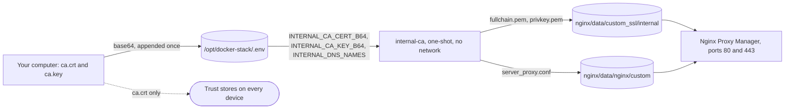
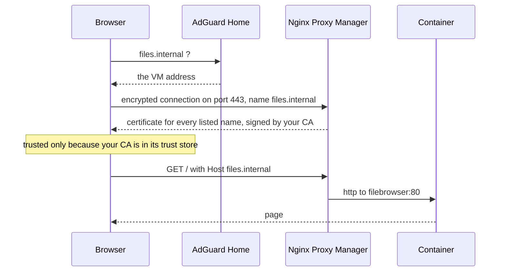

# Local certificate authority for .internal names

> Every `.internal` name answers over `https` with a certificate from your own certificate authority, issued by a one-shot container of the Compose stack, with no click in Nginx Proxy Manager.

---

### What this is and why it exists

A `.internal` name can never get a public certificate, so until now every name in this lab was plain `http`. That is fine for most pages, but it breaks one thing outright: the Proxmox login sets its cookie with the Secure flag, and a browser drops a Secure cookie on a plain `http` page, see [nginx_proxy_manager.md](nginx_proxy_manager.md#proxying-the-proxmox-interface).

A local certificate authority, CA for short, fixes that. You make the CA once on your own computer, put it into `/opt/docker-stack/.env` on the Docker VM, and trust it on every device in the house. A one-shot service in [compose.yaml](compose.yaml), `internal-ca`, then signs one certificate for every name you list and installs a small include file into Nginx Proxy Manager, so every proxy host answers on port 443 as well as on port 80. The SSL tab of every proxy host stays on None.

Nothing here is reachable from the internet, and nothing about plain `http` changes. Both `http://<name>.internal` and `https://<name>.internal` work.

---

### How it works



Nginx Proxy Manager 2.15.1 ends every proxy host it writes with `include /data/nginx/custom/server_proxy[.]conf;`, line 51 of `backend/templates/proxy_host.conf` at tag v2.15.1 of https://github.com/NginxProxyManager/nginx-proxy-manager, read on 2026-10-24. The square brackets make the include optional, so nothing happens until the file exists. [internal-ca/server_proxy.conf](internal-ca/server_proxy.conf) is that file: two `listen 443 ssl` lines, one for IPv4 and one for IPv6, and the certificate and key. Every proxy host, present and future, picks it up.

The IPv6 line follows the proxy's own setting. At every start, `docker/rootfs/etc/s6-overlay/s6-rc.d/prepare/50-ipv6.sh` of the same tag comments out every `listen [::]` line under `/data/nginx` when `DISABLE_IPV6` is set, this file included, and leaves it alone otherwise.

The job lives in [internal-ca/issue.sh](internal-ca/issue.sh). It refuses to start, exit 3, unless the CA certificate says `CA:TRUE`, carries the critical name constraint described below, and matches the key. It refuses, exit 2, any name that is not a plain name under `.internal`. Then it issues a new certificate only when one of these is true:

1. There is no certificate yet.
2. The certificate does not verify against the CA in `.env`, which is what happens after you replace the CA.
3. Fewer than 30 days remain.
4. The name list in `INTERNAL_DNS_NAMES` changed.

Otherwise it keeps the certificate and only reinstalls the include file. The certificate is EC P-256, valid 397 days, with every name as its own subject alternative name, `serverAuth` as its only extended key usage, and the private key in `privkey.pem`, mode 600. Both files get the owner of `/data/custom_ssl`, which is the user Nginx Proxy Manager runs as. That is root unless you set `PUID`, because `docker/rootfs/usr/bin/common.sh` defaults `PUID` to 0 and `nginx/run` starts nginx with `s6-setuidgid "$PUID:$PGID"`.

Nginx Proxy Manager starts only after the job exited 0, through `depends_on` with `condition: service_completed_successfully`. When the job fails during `docker compose up -d`, Compose prints `service "internal-ca" didn't complete successfully: exit 2` and stops, and a proxy that was already running keeps running.

Nginx reads the certificate when it starts or reloads, and nothing reloads it when only the certificate changed, so after a new certificate the proxy needs a restart. Every `.internal` name is down for a few seconds:

```bash
docker restart nginx-proxy-manager
```

The path of one request:



---

### The name constraint

A CA that your devices trust could sign a certificate for any name, your bank included, so its key is as valuable as every password you type into a browser. The name constraint limits that. The CA carries a critical `nameConstraints` extension that permits only names under `internal` and excludes every IPv4 and IPv6 address, so even a stolen key cannot sign a certificate that a checking browser accepts for anything outside `.internal`.

The constraint is written `permitted;DNS:internal`, without a leading dot. RFC 5280 says any name made by adding labels on the left matches, and the comment in `lib/mozpkix/lib/pkixnames.cpp` of https://github.com/nss-dev/nss, read on 2026-10-24, confirms whole labels only: `files.internal` matches, `evilinternal` does not. A leading dot, `.internal`, means the same in NSS but is an extension of the standard, so the plain form is the one every verifier reads alike. IP addresses are excluded because a constraint on one name type leaves the other types free.

Who honours it on a CA you added yourself, read in the source on 2026-10-24:

| Verifier | Honours the constraint | Source |
|---|---|---|
| Chrome and Chromium on Linux | Yes | `net/cert/internal/trust_store_nss.cc` of https://github.com/chromium/chromium marks every CA from the NSS database `WithEnforceAnchorConstraints()`, and `ApplyTrustAnchorConstraints` in `pki/verify_certificate_chain.cc` of https://github.com/google/boringssl then adds the anchor's name constraints |
| Firefox | Yes | `PathBuildingStep::Check` in `lib/mozpkix/lib/pkixbuild.cpp` of NSS checks the name constraints of every issuer, the trust anchor included |
| curl and other programs built on OpenSSL | Yes | `check_name_constraints` in `crypto/x509/x509_vfy.c` of OpenSSL 3.5 walks every certificate of the chain, and the proof below shows it |
| Windows, macOS, iPhone, Android | Not checked | No source was read for these. The CA still works there, only this extra protection may be missing |

Proof in throwaway containers on 2026-10-24, with a test CA made the same way: `openssl verify` from OpenSSL 3.5.9 answered `permitted subtree violation` for certificates signed for `example.com`, `proxmox.internal.example.com` and `evilinternal`, `excluded subtree violation` for `192.168.1.10`, and `OK` for `files.internal`. NSS 3.110 `vfychain`, with the test CA trusted as `C,,`, answered `Chain is bad!` for `example.com` and `Chain is good!` for `files.internal`. NSS printed error -8157 rather than its name constraint error, so the proof is the difference between the two results, not the message.

---

### Why every name is listed, not *.internal

A wildcard would save adding names, but Chrome refuses it. `X509Certificate::VerifyHostname` in `net/cert/x509_certificate.cc` of Chromium, read on 2026-10-24, refuses a wildcard directly under a registry controlled domain and says "unknown top-level domains (such as 'intranet' domains or new TLDs/gTLDs not yet added to the registry controlled domain dataset) are also implicitly prevented". `*.internal` is exactly that case, so the certificate lists every name instead, and a new name means one more entry in `INTERNAL_DNS_NAMES`.

---

### Make the CA

Do this once, on your own computer, in a folder only you can read, never in a repository. `<ca-dir>` is that folder. Every command runs openssl in a throwaway container, so nothing needs installing. Use a common name you will recognise in a trust store, with the year, so a later replacement is easy to tell apart.

Create the folder. Unix shell:

```bash
mkdir -m 700 <ca-dir>
```

PowerShell:

```powershell
New-Item -ItemType Directory <ca-dir>
```

Make the key. Unix shell:

```bash
docker run --rm --network none -u "$(id -u):$(id -g)" -v <ca-dir>:/ca -w /ca alpine/openssl:3.5.9@sha256:bf66acee200e5f4959af448eafc9be0634d8ecdf42205873c83cd5ddffb1cdfd genpkey -algorithm EC -pkeyopt ec_paramgen_curve:P-256 -out ca.key
```

PowerShell:

```powershell
docker run --rm --network none -v "<ca-dir>:/ca" -w /ca alpine/openssl:3.5.9@sha256:bf66acee200e5f4959af448eafc9be0634d8ecdf42205873c83cd5ddffb1cdfd genpkey -algorithm EC -pkeyopt ec_paramgen_curve:P-256 -out ca.key
```

Make the CA certificate, valid 10 years. Unix shell:

```bash
docker run --rm --network none -u "$(id -u):$(id -g)" -v <ca-dir>:/ca -w /ca alpine/openssl:3.5.9@sha256:bf66acee200e5f4959af448eafc9be0634d8ecdf42205873c83cd5ddffb1cdfd req -x509 -new -key ca.key -sha256 -days 3650 -subj "/CN=<ca-name>" -addext "basicConstraints=critical,CA:TRUE,pathlen:0" -addext "keyUsage=critical,keyCertSign,cRLSign" -addext "nameConstraints=critical,permitted;DNS:internal,excluded;IP:0.0.0.0/0.0.0.0,excluded;IP:::/::" -out ca.crt
```

PowerShell:

```powershell
docker run --rm --network none -v "<ca-dir>:/ca" -w /ca alpine/openssl:3.5.9@sha256:bf66acee200e5f4959af448eafc9be0634d8ecdf42205873c83cd5ddffb1cdfd req -x509 -new -key ca.key -sha256 -days 3650 -subj "/CN=<ca-name>" -addext "basicConstraints=critical,CA:TRUE,pathlen:0" -addext "keyUsage=critical,keyCertSign,cRLSign" -addext "nameConstraints=critical,permitted;DNS:internal,excluded;IP:0.0.0.0/0.0.0.0,excluded;IP:::/::" -out ca.crt
```

`pathlen:0` means the CA can sign certificates for servers but no further CA. OpenSSL writes the IPv6 exclusion as `IP:::/::`, an address and a mask, and refuses `IP:::/0` with `bad ip address`.

Keep both files readable by you alone. Unix shell:

```bash
chmod 600 <ca-dir>/ca.key <ca-dir>/ca.crt
```

Read the result back. The output must show `CA:TRUE, pathlen:0`, `Permitted: DNS:internal` and the two excluded addresses:

```bash
docker run --rm --network none -u "$(id -u):$(id -g)" -v <ca-dir>:/ca -w /ca alpine/openssl:3.5.9@sha256:bf66acee200e5f4959af448eafc9be0634d8ecdf42205873c83cd5ddffb1cdfd x509 -in ca.crt -noout -subject -enddate -fingerprint -sha256 -ext basicConstraints,keyUsage,nameConstraints
```

`ca.key` is the one file that must never leave your computer except into `.env` on the VM. Back it up the way you back up a password manager. `ca.crt` is public, it is what every device trusts.

---

### Put the CA into .env

The job reads three values from `/opt/docker-stack/.env`, next to the Samba login:

| Key | Value |
|---|---|
| `INTERNAL_CA_CERT_B64` | `ca.crt` in base64, on one line |
| `INTERNAL_CA_KEY_B64` | `ca.key` in base64, on one line |
| `INTERNAL_DNS_NAMES` | Every name, separated by commas, for example `files.internal,plex.internal` |

The job gets the values as environment variables, so `docker inspect internal-ca` on the VM shows the key too. That adds nobody new: only your login can read `.env`, and an account in the `docker` group is already as strong as root on the VM, see [agent_access.md](agent_access.md).

The Compose file refuses every command for the whole stack while one of them is missing, the same way it does for the Samba login, so add them before you copy the new `compose.yaml` to the VM.

This appends the three lines from your own computer over SSH. The values travel on standard input, so they never appear on a command line of either machine, and `tr` drops the carriage returns PowerShell adds. Unix shell:

```bash
printf 'INTERNAL_CA_CERT_B64=%s\nINTERNAL_CA_KEY_B64=%s\nINTERNAL_DNS_NAMES=%s\n' "$(base64 -w0 <ca-dir>/ca.crt)" "$(base64 -w0 <ca-dir>/ca.key)" '<names>' | ssh <user>@<docker-vm-ip> "umask 077 && tr -d '\r' >> /opt/docker-stack/.env"
```

PowerShell:

```powershell
"INTERNAL_CA_CERT_B64=$([Convert]::ToBase64String([IO.File]::ReadAllBytes('<ca-dir>\ca.crt')))`nINTERNAL_CA_KEY_B64=$([Convert]::ToBase64String([IO.File]::ReadAllBytes('<ca-dir>\ca.key')))`nINTERNAL_DNS_NAMES=<names>" | ssh <user>@<docker-vm-ip> "umask 077 && tr -d '\r' >> /opt/docker-stack/.env"
```

On macOS, if `base64` refuses `-w0`, put `openssl base64 -A -in <ca-dir>/ca.crt` in place of each `base64 -w0 <ca-dir>/ca.crt`, and the same for `ca.key`. That variant has not been run on a Mac. In a throwaway container on 2026-10-24 the PowerShell line, in PowerShell 7.6, wrote the same bytes as the Unix shell line.

Check on the VM that each value is there, without printing it. Every number must be above 0, and the Samba lines must show the same lengths as before:

```bash
awk -F= '{print $1, length($2)}' /opt/docker-stack/.env
```

The steps in [The Samba login file](lan_storage.md#the-samba-login-file) replace the whole file. If you run them again later, append these three lines again afterwards.

---

### Deploy

Create the folder for the two committed files on the VM, as your own login:

```bash
mkdir -p /opt/docker-stack/internal-ca
```

From your own computer, copy the script and the include. Unix shell:

```bash
scp <repo>/homelab/internal-ca/issue.sh <repo>/homelab/internal-ca/server_proxy.conf <user>@<docker-vm-ip>:/opt/docker-stack/internal-ca/
```

PowerShell:

```powershell
scp <repo>\homelab\internal-ca\issue.sh <repo>\homelab\internal-ca\server_proxy.conf <user>@<docker-vm-ip>:/opt/docker-stack/internal-ca/
```

Then copy `compose.yaml` as [Deploying from your clone](README_HOMELAB.md#deploying-from-your-clone) shows. On the VM, run the job and start the proxy after it:

```bash
cd /opt/docker-stack && docker compose up -d internal-ca nginx-proxy-manager
```

Read what the job did. The last lines name every name, the end date and the CA's fingerprint:

```bash
docker logs internal-ca
```

Compose does not recreate a running proxy when only its `depends_on` changed, so restart it once to load the new include:

```bash
docker restart nginx-proxy-manager
```

Check every service:

```bash
cd /opt/docker-stack && docker compose ps -a
```

`internal-ca` shows `Exited (0)`, which is its normal state. A reboot of the VM starts the proxy again without the job, because the job has `restart: "no"` and the certificate stays on disk.

---

### Add a new .internal name

1. Add the proxy host in Nginx Proxy Manager as [nginx_proxy_manager.md](nginx_proxy_manager.md#add-a-proxy-host) says, SSL tab on None.
2. On the VM, open `/opt/docker-stack/.env` in an editor and add the name to the end of the `INTERNAL_DNS_NAMES` line, after a comma.
3. Run the job. Compose sees the changed value and recreates it:

    ```bash
    cd /opt/docker-stack && docker compose up -d internal-ca
    ```

4. Read `docker logs internal-ca`. Its last run says `issuing a new certificate: the name list changed` and lists the new name.
5. Restart the proxy:

    ```bash
    docker restart nginx-proxy-manager
    ```

A name that is in the list but has no proxy host gets no `https`: the proxy's default server refuses the handshake and curl reports `tlsv1 unrecognized name`.

---

### Renewal

The certificate lasts 397 days and nothing renews it by itself. The job issues a new one only when it runs with fewer than 30 days left, so a run 12 months after issue still keeps the old one. Read the end date, the line that starts with `notAfter=`:

```bash
docker logs --tail 2 internal-ca
```

In the last 30 days before that date, run the job and restart the proxy:

```bash
cd /opt/docker-stack && docker compose up -d internal-ca
```

```bash
docker restart nginx-proxy-manager
```

The CA itself lasts 10 years.

---

### Trust the CA

Every device that should open `https://<name>.internal` without a warning needs `ca.crt`, never `ca.key`. Restart the browser afterwards.

Linux, the system store, which curl and most command line programs read. Arch Linux and CachyOS, with `trust` from p11-kit, whose manual page `doc/manual/trust.xml` at https://github.com/p11-glue/p11-kit, read on 2026-10-24, documents `trust anchor` and `--store`:

```bash
sudo trust anchor --store <ca-dir>/ca.crt
```

Debian and Ubuntu. The manual page of `update-ca-certificates`, read on 2026-10-24 at https://manpages.debian.org/trixie/ca-certificates/update-ca-certificates.8.en.html, says a certificate must be PEM with a `.crt` extension, below `/usr/local/share/ca-certificates`:

```bash
sudo cp <ca-dir>/ca.crt /usr/local/share/ca-certificates/<ca-file-name>.crt
```

```bash
sudo update-ca-certificates
```

Linux, Chrome and Chromium. They read the user NSS database in `~/.pki/nssdb`, not the system store. `certutil` comes with the package `nss` on Arch Linux and CachyOS and `libnss3-tools` on Debian and Ubuntu. `C,,` means a CA trusted for websites:

```bash
certutil -d sql:$HOME/.pki/nssdb -A -t "C,," -n "<ca-name>" -i <ca-dir>/ca.crt
```

Linux, Firefox. Each profile has its own database. Recent Firefox keeps the profiles in `~/.config/mozilla/firefox/`, older releases in `~/.mozilla/firefox/`. Close Firefox, then for each profile folder that holds a `cert9.db`:

```bash
certutil -d sql:<profile-dir> -A -t "C,," -n "<ca-name>" -i <ca-dir>/ca.crt
```

Firefox on any system can do the same in its settings: Privacy & Security, Certificates, View Certificates, Authorities, Import, then tick "Trust this CA to identify websites".

Windows, from an administrator PowerShell, for every user of the machine. Chrome and Edge read this store. `-addstore` is documented on https://learn.microsoft.com/en-us/windows-server/administration/windows-commands/certutil, read on 2026-10-24:

```powershell
certutil -addstore -f Root <ca-dir>\ca.crt
```

macOS, for every user, in Terminal. Safari and Chrome read the System keychain. `-d` and `-r trustRoot` are documented in the `security` manual page, read on 2026-10-24 at https://ss64.com/mac/security-cert.html:

```bash
sudo security add-trusted-cert -d -r trustRoot -k /Library/Keychains/System.keychain <ca-dir>/ca.crt
```

iPhone and iPad. Send `ca.crt` to the device, by AirDrop or by opening it in Safari, then Settings, Profile Downloaded, Install. A profile installed this way is not trusted for websites until you turn it on: Settings, General, About, Certificate Trust Settings, then turn on the CA under "Enable full trust for root certificates". Apple's page https://support.apple.com/en-us/102390, read on 2026-10-24, describes that switch. Apple's page https://support.apple.com/en-us/103769 requires a server certificate to have `serverAuth` and to last 825 days or fewer, and this one has `serverAuth` and lasts 397.

Android. Copy `ca.crt` to the phone, then Settings, Security, Encryption and credentials, Install a certificate, CA certificate. The menu names differ between makers. Android's page https://developer.android.com/privacy-and-security/security-config, read on 2026-10-24, says apps trust only the pre-installed system CAs by default, and only apps targeting Android 6.0 or lower also trust user-added ones. So many apps keep refusing your CA even when the browser accepts it, and that cannot be changed from the phone.

None of the trust steps on Windows, macOS, iPhone and Android has been run on a device for this lab yet.

---

### Revoke or replace the CA

A local CA has no revocation list, so revoking it means removing it from every trust store. Do that whenever `ca.key` may have leaked, and once more when the CA is replaced.

Linux system store on Arch Linux and CachyOS:

```bash
sudo trust anchor --remove <ca-dir>/ca.crt
```

Debian and Ubuntu:

```bash
sudo rm /usr/local/share/ca-certificates/<ca-file-name>.crt
```

```bash
sudo update-ca-certificates --fresh
```

Chrome and Chromium on Linux:

```bash
certutil -d sql:$HOME/.pki/nssdb -D -n "<ca-name>"
```

Firefox, with Firefox closed, for each profile:

```bash
certutil -d sql:<profile-dir> -D -n "<ca-name>"
```

Windows, from an administrator PowerShell:

```powershell
certutil -delstore Root "<ca-name>"
```

macOS:

```bash
sudo security delete-certificate -c "<ca-name>" /Library/Keychains/System.keychain
```

iPhone: Settings, General, VPN and Device Management, the profile, Remove Profile. Android: Settings, Security, Encryption and credentials, User credentials, the CA, Remove. Neither has been run on a device for this lab yet.

Then make a new CA with [Make the CA](#make-the-ca), under a new common name, replace the two `INTERNAL_CA_` lines in `/opt/docker-stack/.env` in an editor, run the job and restart the proxy as in [Renewal](#renewal). The job sees that the old certificate does not verify against the new CA and issues a new one, which the test run logged as `issuing a new certificate: the certificate does not verify against the current CA`. Trust the new `ca.crt` on every device.

---

### Troubleshooting

`docker compose` refuses with `required variable INTERNAL_CA_CERT_B64 is missing a value`. The three lines are not in `/opt/docker-stack/.env`. Add them as in [Put the CA into .env](#put-the-ca-into-env).

`docker compose up -d` stops with `service "internal-ca" didn't complete successfully: exit 2`. A name in `INTERNAL_DNS_NAMES` is not a plain name under `.internal`, or the list is empty. `docker logs internal-ca` names it. A wildcard such as `*.internal` is refused on purpose.

Exit 3. The CA is unusable: the certificate does not say `CA:TRUE`, has no critical name constraint permitting `DNS:internal`, or the key belongs to another certificate. `docker logs internal-ca` says which.

The browser says the certificate is not trusted. The CA is not in that browser's trust store, see [Trust the CA](#trust-the-ca). On Linux, Chrome reads `~/.pki/nssdb`, and the system store alone is not enough for it.

The browser shows an old certificate, or a new name is missing from it. The proxy was not restarted after the job issued a new certificate.

`https://<name>.internal` fails with `unrecognized name` while `http` works. The name has no proxy host. Without one, the proxy's default server for port 443 refuses the handshake.

---

### Lab example

The values on this lab, deployed on 2026-10-24:

```text
<ca-dir>         ~/.local/state/agents/workspace/homelab-ca
<ca-name>        Homelab internal CA 2026
<names>          dashboard-proxmox.internal,uptime.internal,syncthing.internal,adguard.internal,nginx-proxmox.internal,notes.internal,files.internal,plex.internal,proxmox.internal,ascend-web-hunter.internal
<user>           lukk
<docker-vm-ip>   192.168.1.12
certificate      valid to 2027-11-25 00:55 UTC, renew from 2027-10-26
CA fingerprint   sha256 57:CC:62:6C:F0:8D:1B:F5:08:5C:74:21:E5:BC:B6:B6:36:F1:58:48:CA:90:CC:14:7B:FF:14:AE:12:69:3D:17
```

What was measured that day, with curl 8.23.0 in a container on the owner's computer, the CA as `--cacert`, through AdGuard Home's answer `192.168.1.12`:

| Name | https status | Certificate check | http status |
|---|---|---|---|
| `dashboard-proxmox.internal` | 200 | 0, verified | 200 |
| `uptime.internal` | 302 to `https://uptime.internal/dashboard` | 0, verified | 302 |
| `syncthing.internal` | 200 | 0, verified | 200 |
| `adguard.internal` | 302 to `https://adguard.internal/login.html` | 0, verified | 302 |
| `nginx-proxmox.internal` | 200 | 0, verified | 200 |
| `notes.internal` | 200 | 0, verified | 200 |
| `files.internal` | 200 | 0, verified | 200 |
| `plex.internal` | 401 at `/`, 200 at `/web/` | 0, verified | 401 |
| `proxmox.internal` | 500 | 0, verified | 500 |
| `ascend-web-hunter.internal` | refused, `tlsv1 unrecognized name` | none | 200, the proxy's Default Site page |

`proxmox.internal` answers 500 over both schemes because its proxy host still has `192.168.1.10:8006` in Forward Hostname, and the proxy log says `invalid port in upstream "192.168.1.10:8006:8006/"`, see [nginx_proxy_manager.md](nginx_proxy_manager.md#the-entries). `ascend-web-hunter.internal` is in the certificate but has no proxy host yet.

Before the lab, the whole path ran in throwaway containers on a private Docker network: the real `jc21/nginx-proxy-manager:2.15.1` with two proxy host files copied from the lab, the job with a test CA, and curl from a second container. Both names answered 200 over `https` with certificate check 0 and over `http`. The proxy served the old certificate until it was restarted, and the new one after. A second run of the job said `the certificate is still good, nothing issued`, a changed name list, a certificate with 10 days left and a replaced CA each made it issue a new one, and a name outside `.internal`, a wildcard, a CA without the name constraint and a key of another CA each made it refuse with exit 2 or 3.
